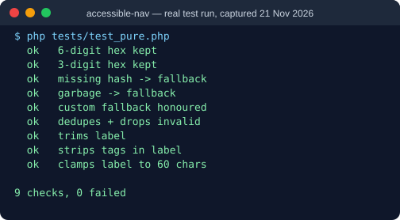

# Accessible Nav (WordPress plugin) — manual

*One page, eight blocks. Every figure here comes from this repository's own tests and README.*

## 1. Claim
Adds an accessibility toolbar and a keyboard/touch command palette with no theme edits. Preferences stay in the visitor's browser, and nothing is sent to a server.

## 2. What it is
A WordPress plugin that gives every visitor text-size, contrast, reduced-motion, readable-font and link-underline controls, plus a ⌘K / Ctrl-K palette to jump to any page in the main menu.

## 3. Demo
Install on a test site and press Ctrl-K. Capture to record: the toolbar and the palette in use.


*Real output from this repository's own tests, captured 21 Nov 2026.*

## 4. Run it yourself
**Prerequisites:** WordPress 6.2+, PHP 7.4+.

```bash
php -l accessible-nav.php
php tests/test_pure.php
# then upload to wp-content/plugins/ and activate
```

## 5. What you will see
Lint passes and the pure-function tests run. After activation, the toolbar appears on every page and Ctrl-K opens the palette.

## 6. 30-second talking point
> Accessibility should not mean rebuilding a theme. Accessible Nav attaches without changing your markup, takes its destinations from your own menu, and respects reduced-motion and colour-scheme preferences.

## 7. Scope and limits
- It enhances navigation and presentation. It cannot fix inaccessible content inside the theme.

## 8. Links
[Repository](https://github.com/fhionnghaile/accessible-nav) · [readme.txt](readme.txt)
